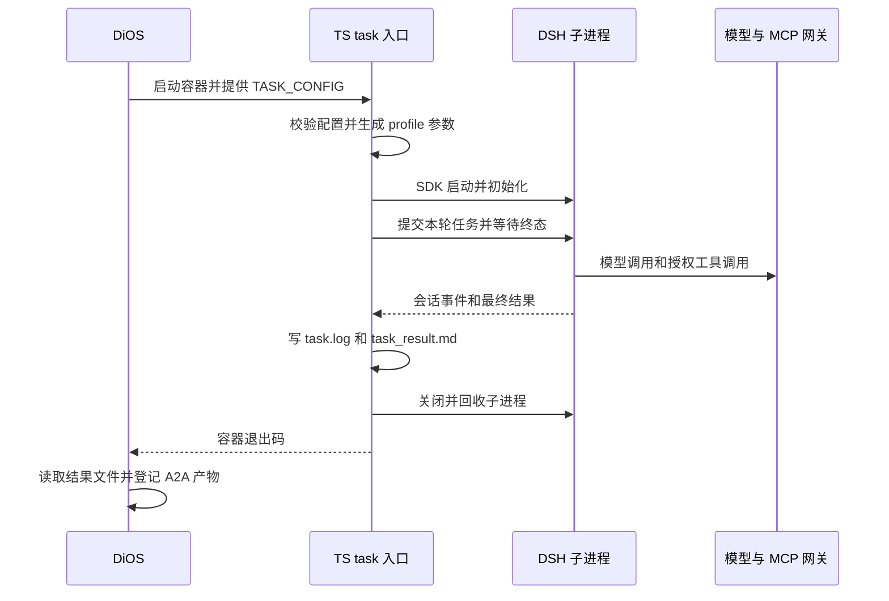
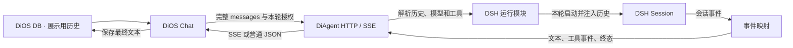
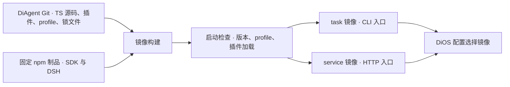

# TypeScript DiAgent 架构设计

本文用于设计 DiAgent 的运行入口、默认配置和插件装配。当前锁定的 DSH 版本以 [package.json](../package.json) 为准，已验收的行为见 [v0.1 待办](TODO.md)。

首个目标是让一条现有 DiOS task 通过更换镜像切到 TypeScript DiAgent。第二个目标是接通常驻 Chat service。DiAgent 同时面向其他项目和外部调度器，任务执行、状态和产物契约可独立使用。

## 1. 选型与交付

**新 DiAgent 使用 TypeScript，依赖固定版本的官方 SDK 与 DSH 运行时，沿用 DiOS 现有 Docker 部署。** DiOS 启动容器、调度任务、发 HTTP 请求、接收状态与产物。DiAgent 在容器内通过 SDK 启动 DSH 子进程、提交任务、接收事件并负责收尾。SDK 的通信对端是 DSH，DiOS 仍通过现有 task 文件与 HTTP 契约调用 DiAgent。 [DSH TS SDK](https://github.com/deepseek-ai/deepseek-harness/blob/dsh-v0.2.2-rc.1/packages/sdk/client/README.md) · [DiOS Docker task](https://github.com/HQIT/DiOS/blob/f2433d950925b773ae33e7c50cb0579dea1d4115/backend/app/services/docker_runner.py#L32) · [DiOS Chat](https://github.com/HQIT/DiOS/blob/f2433d950925b773ae33e7c50cb0579dea1d4115/backend/app/api/apps/chat.py#L139)

**Git 里提交 DiAgent 源码、HQIT 插件、profile、Dockerfile 和依赖锁；镜像里安装可运行的 DSH。** 首选精确版本的 `@deepseek-ai/dsh` 和 `@deepseek-ai/dsh-sdk-client`。SDK 默认解析同版本的 DSH 可执行文件，也可以通过 `dshBin` 指向随镜像安装的版本。若 npm 制品无法在目标 Linux 镜像运行，可在镜像构建阶段检出固定的上游提交，构建运行产物并显式指定路径。引入长期维护的上游源码分支需要有具体的上游缺口作为依据。 [SDK 运行时解析](https://github.com/deepseek-ai/deepseek-harness/blob/dsh-v0.2.2-rc.1/packages/sdk/client/README.md#known-limitations-and-deferred-work)

**外部调度器可直接调用 `TASK_CONFIG` 入口，也可通过宿主机的独立任务 API 提交、查状态和取结果。** 独立 API 为每次任务启动容器。DiOS 集成继续沿用已有任务文件和 HTTP/SSE 契约。 [独立任务 HTTP 接口](../README.md#独立任务-http-接口)

运行架构和共享装配顺序见 [系统与组件 UML](2026-11-diagent-v0.1-system-diagrams.md)。

## 2. 模块拆分

目标设计采用一种 Agent。Task 与 HTTP 是调用入口，共用 `runDshTurn` 和 profile 生成模块。当前两张镜像的运行层相同。Task 与 Chat 分别保留已验证的能力规则，共用模型路由、角色、Skills 发现、Bash 参数、上报开关与补丁写入。按 Agent 的配置分配和镜像入口合并可独立推进。

### 基础与两种默认配置

目标装配顺序是 **基础 → 调用方式默认项 → 部署方或 DiOS 为本次运行授权的能力**。保留完整的 DSH 运行层。基础配置的业务工具列表默认为空，调用方式和授权决定具体工具。下表中的插件 ID 指向已有实现，Task 与 Chat 目前继续使用各自的兼容规则。

| 配置 | 加载的运行插件 | 入口职责与默认权限 |
| --- | --- | --- |
| 初始基础 | `llm-pi-ai` 接模型，`system-prompt` 注入角色，`diagent-task-temperature` 传递模型温度。Task 与 Chat 复用 `diagent-tool-selection` 将显式名单应用到 DSH。 | 完成纯文本运行，显式空名单使用只读策略，模型可见工具列表为空。 |
| 一次性任务默认 | 有工具轮次预算时追加 `diagent-tool-round-limit`。 | 入口准备工作区、产物目录，管理超时、日志和退出码。入口可以写日志和最终结果，Agent 写文件所需的工具与权限仍按本次授权配置。 |
| 常驻对话默认 | 请求携带历史时追加 `diagent-chat-history`。纯文本 SSE 需要逐段输出时追加 `diagent-chat-stream`。 | HTTP 入口返回 JSON 或 SSE。带工具的运行通过事件映射输出工具进度。每轮单独解析模型、上下文和权限，容器可以复用。 |

两个默认配置均可按授权追加以下能力。

| 能力 | 插件或加载项 |
| --- | --- |
| 文件访问 | DSH 文件工具按读、写分别授权。工具列表和工作区权限都应匹配授权。 |
| Skills | `skill-filesystem` 只发现本次获准的目录，并开放所需的 Skill 工具。 |
| MCP | `@deepseek-ai/dsh-mcp-client` 接指定服务。工具范围由 MCP 网关或本地工具白名单限制。 |
| Shell | `bash-sandbox`、`tool-bash` 和旧接口适配 `diagent-legacy-shell`。 |
| 业务事件 | `diagent-publish-event`，附带本次允许的事件发布凭据。 |

初期由 DiAgent 内置这两套默认配置。受管 Chat、常驻 A2A 和一次性 Task 从 DiOS 的 `capabilities.diagent_tools` 取得名单，映射到各入口的 `tool_selection.tool_ids`。一次性 Task 可显式选择 Skills、MCP 和事件发布，模型代理与刷新均开启时也可选择 Shell 和文件工具。MCP 继续由 E2AG 签发单任务授权。省略字段沿用各入口的兼容默认值，显式空名单只做问答。DiOS 按对话轮次和任务终态撤销模型授权。开启 Task 刷新后，由独立 UID 的本地推理代理在访问令牌过期时向 DiOS 换发，DiOS 继续使用任务原有的模型绑定、调用额度和绝对截止。可复用业务配置的新增、保存和分配由后续 DiOS 实现。

迁移时先用旧入口的兼容映射覆盖已验收的行为。例如旧 task 入口仍有默认启用事件的约定，切换到零业务工具的基础前要把这项能力显式写入旧调用的配置。先验证纯文本请求工具列表为空，再用同一个镜像分别运行任务与 Chat，确认两边都只看到各自授权的工具。

| 模块 | 负责的行为与接口 | 代码位置建议 |
| --- | --- | --- |
| Task 入口 | 读 `TASK_CONFIG`，校验 once 配置，调用运行模块，原子写结果和日志，把成功、失败和中断映射为进程退出状态。 | `src/task/` |
| HTTP 入口 | 提供 `/health`、`/v1/chat/completions`，解析现有字段，映射普通 JSON、SSE、工具事件和错误。负责 HTTP 生命周期。 | `src/service/` |
| 配置 | 解析现有模型配置、角色提示、workspace、Skills、MCP、工具白名单与预算，生成本次启动所需的 DSH 配置。只把明确兼容的字段映射过去。 | `src/config/` |
| DSH 运行模块 | 执行一次 DSH 会话，管理 SDK 初始化、通知订阅、终态、截止时间及子进程清理。调用方消费最终结果和运行事件。 | `src/dsh/` |
| DiAgent 插件 | 实现业务工具和协议适配，按每次运行的生效配置加载。 | `src/dsh/plugins/` |
| 运行配置与打包 | 集中生成两种入口的 DSH 补丁。固定 SDK、DSH、Node、插件及依赖。 | `src/dsh/profile.ts`、`docker/`、`package-lock.json` |

DSH 运行模块统一处理 SDK 细节。Task 和 HTTP 调用者拿到的是运行结果和必要事件；现有 Python 版作为独立镜像保留，用于对照和回滚。等第二个真实内核需要接入时，再决定是否抽象出通用运行时接口。

角色提示与工具权限在启动配置里落实。现有 `tool_selection` 对工具可见性的影响须通过真实工具列表验收。DSH 的 SDK profile 默认有自己的 coding persona 和工具集合，需用 HQIT profile 覆盖角色并收敛工具。按选定版本验证 MCP transport、鉴权头、Skills 路径及可见工具。DiOS 集成沿用其 MCP 网关，独立部署使用调用方配置的 MCP。 [DSH SDK profile 配置](https://github.com/deepseek-ai/deepseek-harness/blob/dsh-v0.2.2-rc.2/packages/bundle/sdk-app/cordis.patch.yml) · [DiOS MCP 网关](https://github.com/HQIT/DiOS/blob/f2433d950925b773ae33e7c50cb0579dea1d4115/backend/app/services/e2ag_tool_gateway.py#L118)

## 3. Task 首先实现换镜像

### 图 2 · 一次性任务时序

- **兼容输入与产出。** 用真实 DiOS 生成的配置做样本，覆盖顶层 `models`、`task.model`、`system_prompt`、`skill_names`、`mcp_config_path`、`workspace` 和 `output_dir`。输出遵循配置，DiOS 管理场景应能在 `/workspace/output/events/{run_id}` 收到 `task_result.md`。旧 standalone 的 cron、interval、检查点及子 Agent 配置按实际使用清单验收后再切换。 [配置生成](https://github.com/HQIT/DiOS/blob/f2433d950925b773ae33e7c50cb0579dea1d4115/backend/app/services/a2a_service.py#L446) · [产物读取](https://github.com/HQIT/DiOS/blob/f2433d950925b773ae33e7c50cb0579dea1d4115/backend/app/services/a2a_service.py#L360)
- **确认完成语义。** SDK 的入队回执、会话空闲和任务完成是不同信号。任务有子 Agent 时，验证低层 `session/wait` 的子任务等待语义。结合已记录的终止原因、产物写入和进程退出码判定成功，避免超时、模型失败或子任务未收尾被登记为完成。 [SDK 客户端](https://github.com/deepseek-ai/deepseek-harness/blob/dsh-v0.2.2-rc.1/packages/sdk/client/README.md#lower-level-control-with-harnessclient)
- **分开验证容器停止和 A2A 取消。** TS 入口收到停止信号后应关闭 DSH 并回收进程。当前 DiOS 的 A2A 取消只更新状态并撤销授权。若验收包含点击取消即停止容器，需要在 DiOS 将取消接到对应容器句柄，并处理完成与取消的竞争。 [现有 A2A 取消](https://github.com/HQIT/DiOS/blob/f2433d950925b773ae33e7c50cb0579dea1d4115/backend/app/services/a2a_service.py#L554)

## 4. Chat 的两个设计决策

### 图 3 · 当前会话与事件流

**历史。** DiOS 从数据库重建 `messages`。DiAgent 在每轮的 DSH 会话中注入这段历史。本机已验证旧 DiOS 会话续聊，外部调用者是否仍使用旧的独立会话接口需要在目标环境核对。 [Chat 历史插件](../src/dsh/plugins/chat-history.ts)

**SSE。** 纯文本请求通过 DSH 插件桥接增量。带工具的请求映射工具开始、结束、失败及事件审批，并在模型步骤结束时发送该步文本。 [常驻服务接口](../README.md#typescript--dsh-常驻服务试点)

**进程粒度。** Task 每次运行启动一个 DSH 子进程。Service 可以复用 HTTP 容器，每次调用启动和回收本次的 DSH 子进程。 [共享执行入口](../src/dsh/task-runtime.ts)

## 5. 参考 EduWork 的装配方式

EduWork 构建时从锁定的 npm 制品准备 DSH Runtime 和独立插件包，同时从固定提交构建桌面 Host 和 Electron。对 DiAgent 最有用的是固定上游版本、独立维护插件和构建时装配。新 DiAgent 的 Host 就是面向 DiOS 的 TypeScript task/HTTP 入口。 [EduWork 构建指南](https://github.com/ECNU/EduWork/blob/main/docs/BUILD.md#候选构建做什么)

### 图 4 · 源码与镜像装配

构建时校验版本一致性，在实际锁定版本上复核 profile 及插件字段，执行 profile 检查，确认目标 Linux 容器内的原生依赖、工作区写权限和 DSH 沙箱可用。profile 显式控制默认遥测、Web 工具、模型路由和 MCP。业务 token 由部署注入，插件配置使用引用。运行制品与依赖记录可对应到镜像 digest。 [DSH 插件包规范](https://github.com/deepseek-ai/deepseek-harness/blob/dsh-v0.2.2-rc.2/docs/user/develop/basic/publish.md) · [DSH 默认行为](https://github.com/deepseek-ai/deepseek-harness/blob/dsh-v0.2.2-rc.2/apps/cli/reference/README.md#L119-L133)

## 6. 可行性与实施门槛

| 项目 | 判断 | 首次验收 |
| --- | --- | --- |
| 固定版本随镜像交付 | 路径清楚，待验证目标平台包与 Docker 内启动。 | 同一镜像启动两次，报告相同 DSH/SDK 版本，加载预期 profile，运行一条工作区命令。 |
| task 替换 | 首选切入点。外部契约集中，主要工作在配置和终态映射。 | 同一条 DiOS A2A task 用两个镜像对照。验证角色提示、实际模型、一个 Skill、只读 MCP、文件及报告路径。覆盖模型失败和容器停止。 |
| HQIT 插件 | 有明确的 DSH 插件加载机制，需验证工具授权及参数兼容。 | `publish_event` 只在获准配置中可见。用测试事件验证成功和拒绝，两种结果都能正确返回给 Agent。 |
| Chat 替换 | 主要不确定项。会话历史、流式粒度、取消和进程成本决定适配量。 | 从实际 DiOS 请求跑两轮 Chat、两个并发会话和一个工具调用。核对历史无重复、SSE 与前端行为、状态和断开处理。 |
| 全量替换 | 取决于现有调用清单。 | 查明 `/v1/events`、`/v1/tools`、`/v1/sessions`、独立触发器、子 Agent 配置、检查点的使用情况并确定迁移验收。用新旧镜像配置做一次回滚演练。 |

实施顺序是 **镜像与 profile 冒烟 → 一次性任务验收 → 在线服务与存量调用兼容验收 → 按部署切换**。DiOS 沿用现有的 task 和 service 镜像配置。两类入口通过验收后均使用 TypeScript + DSH，旧 DeepAgents 镜像用于回滚。部署验收优先验证保持镜像标签时，DiOS 持续运行，新任务使用更新后的镜像。修改 Compose 中的镜像选择环境变量时，用原数据库和工作区重新创建 DiOS backend 容器。 [DiOS 镜像配置](https://github.com/HQIT/DiOS/blob/f2433d950925b773ae33e7c50cb0579dea1d4115/backend/app/config.py#L13)

目标环境切换按 [验收指南](2026-11-reviewer-cutover.md) 执行。
